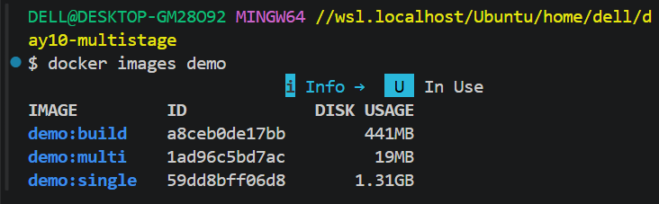
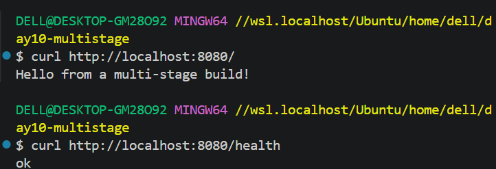
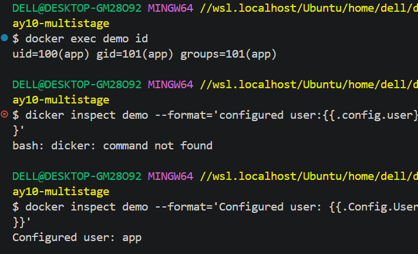
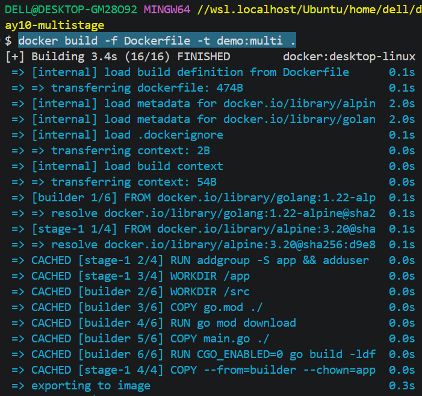
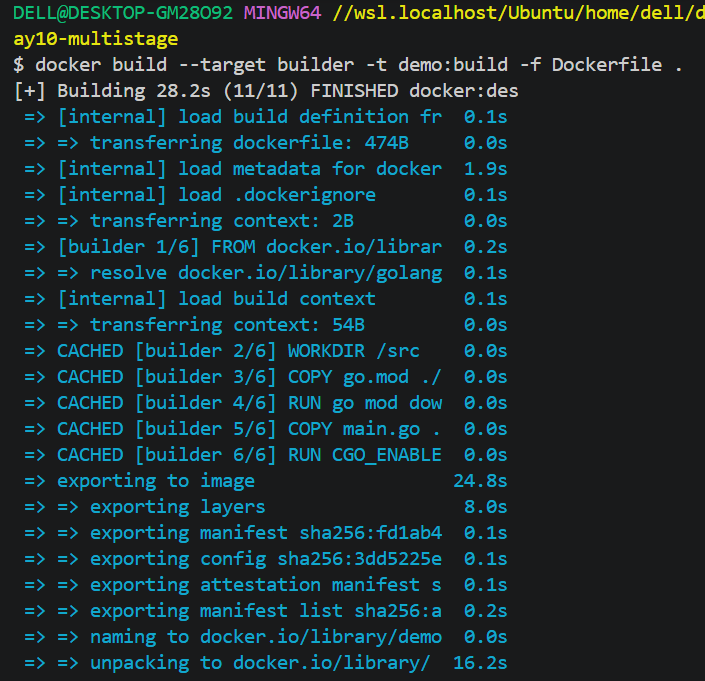
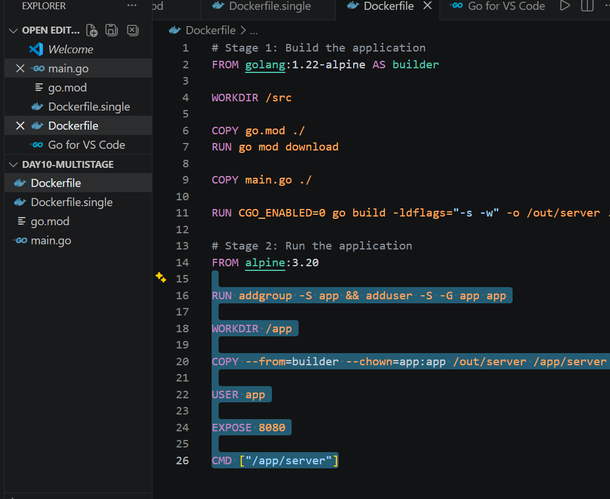

# 🚀 Day 10/90 — Docker Multi-Stage Builds

## 📌 Project Overview

This project demonstrates how to build and optimize a Go application using Docker multi-stage builds.

The goal is to reduce the final Docker image size by separating the build environment from the runtime environment while following container security best practices.

## 🎯 Objectives

* Understand single-stage vs. multi-stage Docker builds.
* Build a Go application inside Docker.
* Reduce the final Docker image size.
* Run the application as a non-root user.
* Test application endpoints.
* Inspect Docker images and build stages.

## 🛠️ Technologies Used

* Docker
* Docker Desktop
* Go
* Alpine Linux
* Git and GitHub
* Visual Studio Code
* Git Bash

## 🏗️ Project Architecture

```text
          Go Application
           main.go
              |
              v
    +----------------------+
    |   Builder Stage      |
    | golang:1.22-alpine   |
    |                      |
    | Compile Go App       |
    +----------------------+
              |
              | COPY --from=builder
              v
    +----------------------+
    |   Runtime Stage      |
    |    alpine:3.20       |
    |                      |
    | Compiled Binary      |
    | Non-root User: app   |
    +----------------------+
              |
              v
       Application :8080
              |
        +-----+------+
        |            |
        v            v
       /          /health
        |            |
        v            v
      Hello!         ok
```

## 📂 Project Structure

```text
day10-multistage/
├── main.go
├── go.mod
├── Dockerfile
├── Dockerfile.single
├── .dockerignore
├── README.md
└── screenshots/
    ├── 01-image-size-comparison.png
    ├── 02-application-health-check.png
    ├── 03-non-root-verification.png
    ├── 04-multi-stage-build.png
    ├── 05-builder-stage.png
    └── 06-dockerfile.png
```

## 🧑‍💻 Application Details

The Go application provides two HTTP endpoints.

| Endpoint  | Expected response                 |
| --------- | --------------------------------- |
| `/`       | `Hello from a multi-stage build!` |
| `/health` | `ok`                              |

The application listens on port `8080`.

## 🐳 Single-Stage Docker Build

The single-stage Dockerfile uses the Go image to compile and run the application in the same image.

Build the image:

```bash
docker build -f Dockerfile.single -t demo:single .
```

Inspect the image:

```bash
docker images demo
```

This approach is straightforward, but the final image retains the Go build environment.

## 🐳 Multi-Stage Docker Build

The multi-stage Dockerfile uses two stages.

### Stage 1 — Builder

* Uses `golang:1.22-alpine`.
* Copies the application source code.
* Compiles the Go application.
* Produces the executable at `/out/server`.

### Stage 2 — Runtime

* Uses `alpine:3.20`.
* Copies only the compiled executable from the builder.
* Creates a non-root user named `app`.
* Runs the application as the non-root user.

Build the image:

```bash
docker build -f Dockerfile -t demo:multi .
```

Build only the builder stage:

```bash
docker build --target builder -t demo:build -f Dockerfile .
```

## 📉 Docker Image Size Comparison

Measured results from my environment:

| Image                        |        Size |
| ---------------------------- | ----------: |
| Single-stage (`demo:single`) | 1246.90 MiB |
| Multi-stage (`demo:multi`)   |   18.15 MiB |
| Approximate size reduction   |  **98.54%** |

### Image Size Reduction Formula

```text
Reduction (%) =
((Single-stage size - Multi-stage size)
 / Single-stage size) × 100
```

The multi-stage image is substantially smaller because the Go compiler and other build tools are not included in the final runtime image.

> Note: Image sizes can vary by platform, image version, and Docker's displayed size calculation.

## ▶️ Run the Application

Start the container:

```bash
docker run -d --name demo -p 8080:8080 demo:multi
```

Verify the container:

```bash
docker ps
```

View container logs:

```bash
docker logs demo
```

## 🧪 Application Testing

### Test the home page

```bash
curl http://localhost:8080/
```

Expected output:

```text
Hello from a multi-stage build!
```

### Test the health endpoint

```bash
curl http://localhost:8080/health
```

Expected output:

```text
ok
```

## 🔐 Non-Root Container Verification

Check the user inside the container:

```bash
docker exec demo id
```

Inspect the configured user:

```bash
docker inspect demo --format='Configured user: {{.Config.User}}'
```

Expected configured user:

```text
app
```

Running as a non-root user reduces the privileges available to the application and supports the principle of least privilege.

## 🔍 Docker Image Inspection

Inspect image history:

```bash
docker history demo:multi
```

Inspect image details:

```bash
docker image inspect demo:multi
```

List project images:

```bash
docker images demo
```

## 📸 Project Screenshots

### 1. Docker Image Size Comparison



### 2. Application and Health Check



### 3. Non-Root Container Verification



### 4. Multi-Stage Build Success



### 5. Builder Stage Verification



### 6. Dockerfile Implementation



## 🛠️ Troubleshooting

### Container name already exists

```bash
docker ps -a
docker rm -f demo
```

Recreate the container:

```bash
docker run -d --name demo -p 8080:8080 demo:multi
```

### Application is not responding

```bash
docker ps -a
docker logs demo
```

### Port 8080 is already in use

Use another host port:

```bash
docker run -d --name demo -p 8081:8080 demo:multi
```

Test it:

```bash
curl http://localhost:8081/
```

## 📚 Key Learnings

* Built a Go application using Docker.
* Understood the difference between single-stage and multi-stage builds.
* Used `COPY --from=builder` to transfer build artifacts between stages.
* Compared Docker image sizes.
* Verified application endpoints.
* Configured a non-root runtime user.
* Inspected image history and build stages.
* Practiced container troubleshooting.

## 🚀 Future Improvements

* Add Docker `HEALTHCHECK` support.
* Pin base images to verified digests for reproducible builds.
* Add automated tests to the build workflow.
* Integrate Docker image scanning.
* Automate builds using GitHub Actions.

## 👨‍💻 Author

**Pooja Thakre**

Aspiring Cloud / DevOps Engineer

Currently learning AWS, Linux, Docker, Git, and DevOps practices.

## 🏁 Conclusion

This hands-on project demonstrates how Docker multi-stage builds can significantly reduce image size while keeping the build environment separate from the runtime environment.

The final multi-stage image measured **18.15 MiB**, compared with **1246.90 MiB** for the single-stage image, representing an approximately **98.54% reduction** in my environment.
